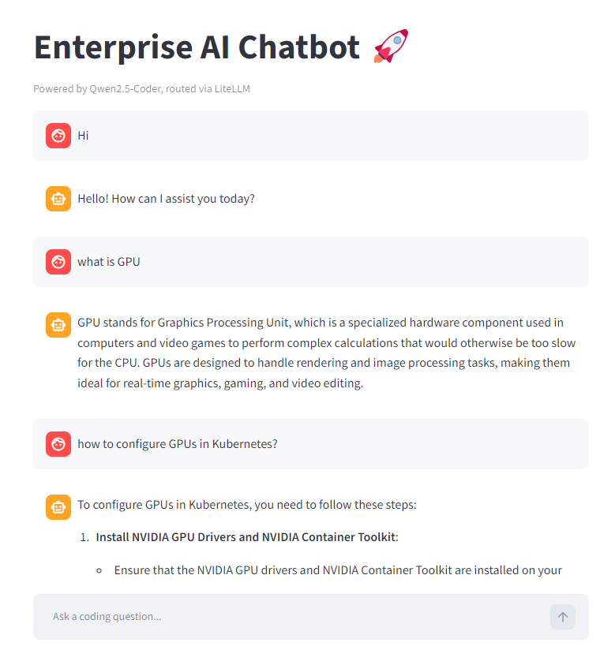
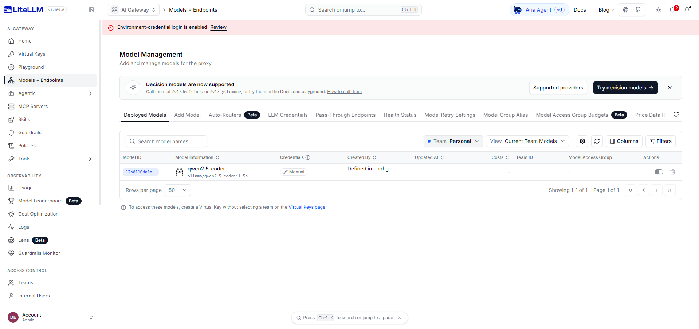
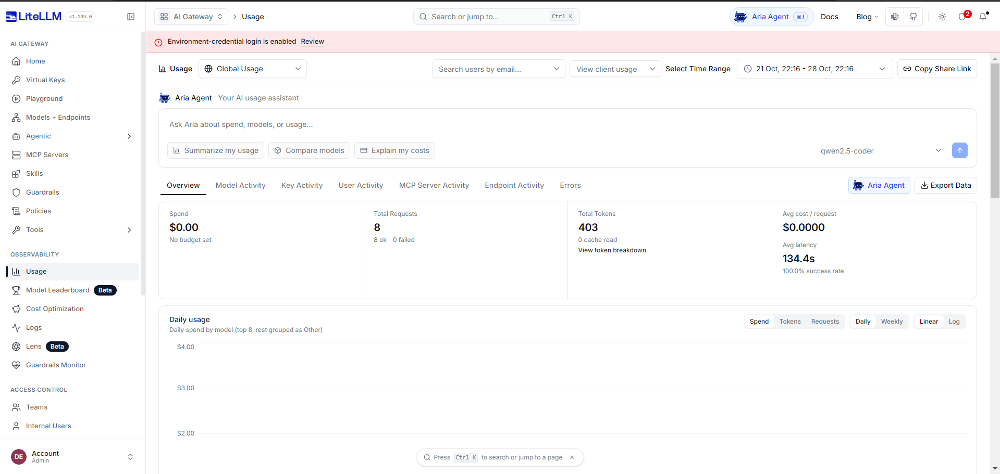
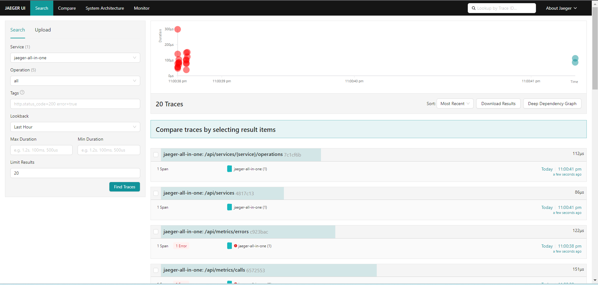
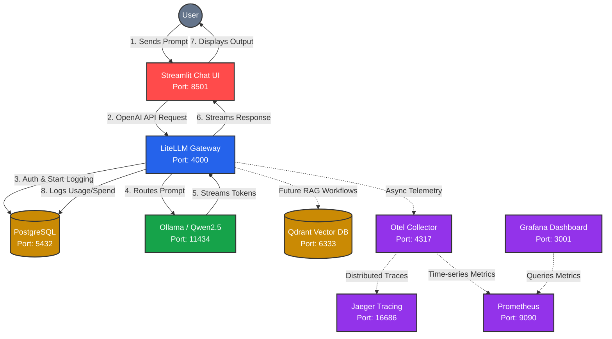

# 🚀 Enterprise GenAI & MLOps Platform (CPU-Optimized)

This repository contains the configuration and infrastructure-as-code for a fully local, self-hosted Generative AI and MLOps platform. Designed to run efficiently on CPU-only nodes, this stack bypasses heavy GPU requirements by utilizing AVX2-optimized inference while maintaining an enterprise-grade observability and API routing layer.

## 🏗️ Architecture Components

### 1. Frontend & Application Layer
*   **Streamlit:** The interactive web-based chat interface. It acts as the user-facing client, accepting prompts and rendering the streaming responses[cite: 6]. It is configured to communicate with the AI Gateway using standard OpenAI-compatible API calls.

### 2. AI Gateway & Routing
*   **LiteLLM:** Acts as the central orchestrator and proxy. Instead of applications talking directly to the inference engine, they route through LiteLLM. This provides:
    *   A unified OpenAI-compatible API endpoint.
    *   Centralized token tracking and usage metrics (e.g., tracking total requests and token counts)[cite: 5].
    *   Virtual key management and rate limiting.
    *   Backed by a **PostgreSQL (17.6)** database to persist user data, keys, and spend logs.

### 3. Inference Engine
*   **Ollama:** The core local execution environment. We transitioned from vLLM to Ollama to achieve stable, high-performance inference on CPU architecture. 
*   **Model (`Qwen2.5-Coder:1.5b`):** A highly capable, lightweight coding model that runs natively within Ollama, answering technical queries directly from the local hardware[cite: 6].

### 4. Knowledge Base (RAG) Ready
*   **Qdrant:** A high-performance vector database. While the current chatbot operates on base model knowledge, Qdrant is provisioned alongside the stack to store high-dimensional text embeddings, enabling future Retrieval-Augmented Generation (RAG) workflows.

### 5. Observability Pipeline
*   **OpenTelemetry (Otel) Collector:** Intercepts tracing and metric data generated by LiteLLM.
*   **Jaeger:** Receives distributed traces from Otel, allowing us to visualize the exact latency and lifecycle of every LLM request.
*   **Prometheus & Grafana:** Prometheus scrapes time-series metrics from the platform, which are then visualized in Grafana dashboards for real-time infrastructure monitoring.

---

---

## 🔄 The Request Workflow

1.  **User Input:** A user submits a query (e.g., "what is GPU") via the **Streamlit** Chat UI[cite: 6].
2.  **API Routing:** Streamlit sends the prompt as a JSON payload to the **LiteLLM** Gateway (Port 4000).
3.  **Telemetry Capture:** LiteLLM registers the request, logs the start time to **PostgreSQL**, and emits a trace to the **Otel Collector**.
4.  **Local Inference:** LiteLLM forwards the prompt to **Ollama** (Port 11434). Ollama processes the text through the local `Qwen2.5-Coder` model using the host's CPU cores and streams the response back.
5.  **Metric Calculation:** LiteLLM intercepts the returning data, calculates the total token usage and latency, updates the Admin UI dashboard[cite: 5], and forwards the final text back to **Streamlit** for the user to read[cite: 6].
